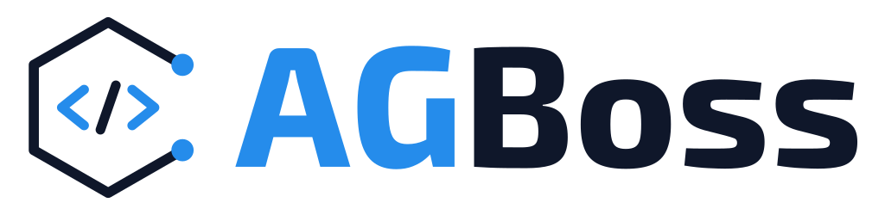

<p align="center">
  <picture>
    <source media="(prefers-color-scheme: dark)" srcset="./agboss-wordmark-dark.svg">
    
  </picture>
</p>

<p align="center">
  <b>The application framework for LangGraph agents in TypeScript.</b><br>
  Decorators, dependency injection, budgets and per-component tests — inside the Node.js backend you already have.
</p>

<p align="center">
  <a href="https://agboss.dev">Docs</a> ·
  <a href="https://www.npmjs.com/package/agboss">npm</a> ·
  <a href="https://x.com/agbossjs">X</a> ·
  <a href="https://www.linkedin.com/company/agbossjs">LinkedIn</a>
</p>

---

- **Structure** — agents, tools, MCP servers and knowledge bases are decorator components, wired by a `@Workflow` module with constructor dependency injection; the whole graph lives in one workflow file and every assembly violation is reported at once, before a single model call.
- **Cost control** — per-run and per-day limits in code, exact cost of every call, cheap routing on decision models.
- **Confidence** — regression suites for every model-answering component, plus evaluation and tracing.

Bring your own backend — no platform, no lock-in. Apache 2.0 licensed.

## Repositories

| Repo | What it is |
| --- | --- |
| [**agboss**](https://github.com/agbossjs/agboss) | The framework: components, DI, the flow DSL, CLI, testing |
| [**agboss.dev**](https://github.com/agbossjs/agboss.dev) | Source for the documentation site |

## Quick start

```bash
npx -p agboss-cli agboss create my-agents
cd my-agents && cp .env.example .env && npm run chat
```

Full guide: [agboss.dev](https://agboss.dev) · Questions: [hello@agboss.dev](mailto:hello@agboss.dev) · Security reports: [security@agboss.dev](mailto:security@agboss.dev)
